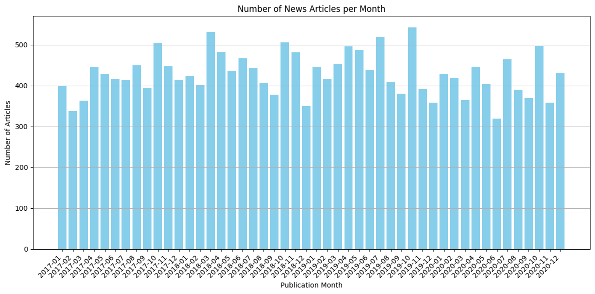

# Financial News Sentiment and Stock Returns

Can the text of financial news predict stock returns? This project applies transformer-based NLP to **~20,500 Wall Street Journal articles (2017–2020)** tagged with S&P 500 tickers and compares two approaches:

1. **Pretrained FinBERT.** An off-the-shelf financial sentiment model (`yiyanghkust/finbert-tone`) scores each article as positive, neutral or negative.
2. **BERT embeddings + MLP.** Articles are encoded with a frozen `bert-base-uncased` model, and a neural network is trained on the embeddings to predict the mentioned stock's **next-day return**.

Both signals are evaluated on a locked 2020 holdout, at the article level and aggregated monthly against S&P 500 returns.

**Tech stack:** Python · PyTorch · Hugging Face Transformers · BERT / FinBERT · scikit-learn · pandas · NumPy · Matplotlib · Seaborn · Jupyter



## Pipeline

```
WSJ articles (title + body, ticker tags)        Daily close prices (480 stocks + S&P 500)
              │                                                │
   head+tail truncation to 512 tokens                 next-day return per article
              │                                                │
     ┌────────┴─────────┐                                      │
     │                  │                                      │
  FinBERT          frozen BERT [CLS]                           │
  sentiment        embedding (768-d)                           │
     │                  │                                      │
     │        MLP regressor ◄──────────────────────────────────┘
     │        (10 configs, expanding-window time-series CV,
     │         trained on 2017–2019, tested on 2020)
     │                  │
     └──────┬───────────┘
            │
  Evaluation on 2020 holdout:
   • article level: test R², MSE, down / neutral / up classification
   • market level:  monthly signal vs next-month S&P 500 return
```

## Key design decisions

- **Handling long articles.** BERT models accept at most 512 tokens, and many WSJ articles are longer. Following Sun et al. (2019), *How to Fine-Tune BERT for Text Classification?*, each article keeps its first 128 and last 382 tokens. The ledes carry the headline facts and the endings often carry analyst commentary and guidance. The headline is prepended to the body, and a diagnostic cell measures how much content this truncation actually discards on this corpus.
- **No look-ahead.** Each article is matched to the stock's return on the **next** trading day after publication. Hyperparameters are chosen with expanding-window `TimeSeriesSplit` cross-validation on 2017–2019, so every validation fold lies after its training data, and 2020 stays untouched until the final evaluation.
- **Efficient experimentation.** BERT embeddings are computed once and reused across all 10 hyperparameter configurations × 4 folds, which makes a proper time-series CV sweep affordable.
- **A fair 3-class comparison.** "Neutral" is defined as a return within ±0.25 standard deviations of zero. FinBERT's native 3-way output and the MLP's predicted return are both mapped to down / neutral / up and compared against the same labels.

## Results (2020 holdout)

<!-- Fill these in after running the notebook top to bottom -->

| | FinBERT | BERT + MLP |
|---|---|---|
| Article-level test R² (vs zero forecast) | – | _TBD_ |
| Article-level test MSE | – | _TBD_ |
| 3-class accuracy / macro F1 | _TBD_ | _TBD_ |
| Monthly signal vs next-month S&P 500, R² | _TBD_ | _TBD_ |

<p align="center">
  
  
</p>

**Interpreting the market-level results.** The monthly regressions use only 12 data points (one per month of 2020), a year dominated by the COVID crash and rebound. They describe how the signals moved with the market during that year rather than demonstrate a reliable trading signal, and the sign of the relationship should be read with that in mind. Daily single-stock returns are extremely noisy, so article-level R² close to zero is the norm in this literature.

## Data

The dataset is **not included** in this repository: the news articles are copyrighted WSJ content. The notebook expects two CSV files in `data/` (or in the folder set by the `DATA_DIR` environment variable):

- `news.csv` with columns `publication_datetime`, `title`, `body`, `tickers`
- `price.csv` with columns `Date`, `ticker`, `close` (including `SPX` for the S&P 500 index)

## Getting started

```bash
git clone https://github.com/survival233/financial-news-sentiment-returns.git
cd financial-news-sentiment-returns
pip install -r requirements.txt
# put news.csv and price.csv in data/ (or set DATA_DIR), then:
jupyter notebook news_sentiment_returns.ipynb
```

A CUDA GPU is strongly recommended: the notebook runs two BERT-size models over every article. The pretrained models are downloaded automatically from the Hugging Face Hub on first run. Plots are saved to `figures/`, and FinBERT scores to `outputs/`.

## Project structure

```
├── news_sentiment_returns.ipynb   # Full pipeline
├── figures/                       # Plots used in this README
├── requirements.txt
└── README.md
```

## References

- Huang, A., Wang, H., & Yang, Y. (2023). FinBERT: A Large Language Model for Extracting Information from Financial Text. *Contemporary Accounting Research*.
- Sun, C., Qiu, X., Xu, Y., & Huang, X. (2019). How to Fine-Tune BERT for Text Classification? *arXiv:1905.05583*.
- Devlin, J., Chang, M.-W., Lee, K., & Toutanova, K. (2019). BERT: Pre-training of Deep Bidirectional Transformers for Language Understanding. *NAACL*.
